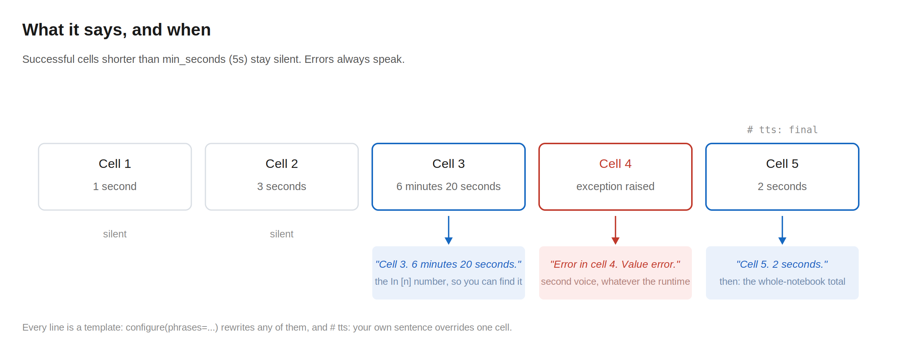

# jupyter-tts-alerts


> *Go and make a coffee. Your notebook will shout if it needs you.*

Your Jupyter notebook announces out loud when a long cell finishes, how long it took, and whether it
crashed, so you don't have to sit watching a progress bar for six hours.



## Highlights

- **Leave the room.** Long runs tell you when they're done from anywhere you can hear.
- **Failures sound different.** Errors are announced in a second voice, and named
  (*"Error in cell 12. Out of memory error."*) so you know whether to bother walking back.
- **Quiet while you work.** Anything under five seconds says nothing, so you're not narrated at
  while writing code.
- **One import.** `import jupyter_tts_alerts` and there is nothing else to do.
- **Silence any cell** with a `# tts: off` comment, or make it say something specific with
  `# tts: the model has finished training`.
- **Nothing to install but a voice.** No Python dependencies at all, not even IPython, which is
  the host it plugs into rather than a library it uses.

## Overview

Written as a side-project during my dissertation, where I was running lengthy notebooks that took six
or more hours a pass. Sitting at a desk watching a spinner is a poor use of an afternoon, but so is
coming back after an hour to find it died on cell 9 forty minutes ago.

It hooks IPython's `pre_run_cell` and `post_run_cell` events, so nothing in your notebook has to
change. The cell number it reads out is the `In [n]` number beside the cell, so you can find the
thing it is talking about.

### Author

Built by [@NotEoin](https://github.com/NotEoin)

## Installation

```bash
pip install jupyter-tts-alerts
```

On Linux you also need a speech engine; macOS and Windows already have one:

```bash
sudo apt install espeak-ng        # or speech-dispatcher, if you prefer
```

| Platform | Engine used | Install |
|---|---|---|
| Linux | `espeak-ng`, `espeak`, or `spd-say` | `sudo apt install espeak-ng` |
| macOS | `say` | ships with the OS |
| Windows | SAPI, via PowerShell | ships with the OS |
| Android (Termux) | `termux-tts-speak` | `pkg install termux-api` |

## Usage

Run it once in your notebook and forget about it:

```python
import jupyter_tts_alerts
```

That's the whole setup: importing it hooks it into the kernel. (`%load_ext jupyter_tts_alerts`
does the same thing if you prefer magics.) From then on:

- Cells under 5 seconds: silent
- Longer cells: *"Cell 12. 6 minutes 20 seconds."*
- Errors: announced immediately, in the other voice: *"Error in cell 12. Value error."*

**Want to hear it first?** [`notebooks/example.ipynb`](https://github.com/NotEoin/jupyter-tts-alerts/blob/main/notebooks/example.ipynb)
is a fifteen-second stand-in for a long run: load, train, save, then a crash, with each step
saying what you should hear.

**Not sure it's working?** [`notebooks/verify-alerts.ipynb`](https://github.com/NotEoin/jupyter-tts-alerts/blob/main/notebooks/verify-alerts.ipynb) walks
through every feature and tells you what you should hear at each step.

### Per-cell directives

Put any of these in a comment, anywhere in a cell, on its own line or after code:

```python
# tts: off                              stay quiet about this cell
# tts: always                           announce it however fast it was
# tts: final                            also announce the total notebook runtime
# tts: the model has finished training   say that instead of the usual phrasing
```

`# tts: final` on your last cell is the useful one: you get told the whole run is finished and how
long it took. The tags from the original script, `# noannounce` and `# notebook-complete`, still
work exactly as they did.

To say a sentence that is itself a keyword, put `say` in front: `# tts: say done` says "done"
rather than marking the last cell. A leading `say` is always dropped, so `# tts: say say cheese`
says "say cheese".

In a cell magic whose body is not Python, such as `%%bash`, put the directive on a line of
its own. If the body has a quote Python cannot pair (`It's`), a directive after code is not seen.

A directive is only a directive in a real comment, so a `# tts:` line inside a docstring or a
string of generated code is left alone. And a keyword only counts on its own: `# tts: done` ends
the notebook, while `# tts: done training the model` is a sentence that happens to start with it.

### Settings

```python
from jupyter_tts_alerts import configure

configure(min_seconds=60, volume=80, notify=True)
```

| Setting | Default | What it does |
|---|---|---|
| `enabled` | `True` | Master switch; `say()` and `test()` obey it too |
| `min_seconds` | `5.0` | Seconds before a successful cell is announced |
| `min_error_seconds` | `0.0` | Raise this if you'd rather typos didn't announce themselves |
| `announce_start` | `True` | Say something when alerts are switched on |
| `announce_cells` | `True` | Announce cells that finish |
| `announce_errors` | `True` | Announce cells that fail |
| `announce_interrupts` | `False` | Announce cells you stopped yourself |
| `engine` | auto | `espeak-ng`, `spd-say`, `say`, `sapi`, `termux`, or `none` |
| `voice` / `error_voice` | engine's choice | See `%tts voices` |
| `volume` | `50` | 0 to 100, where **50 is the engine's own normal level**; no effect on Termux |
| `rate` | `0` | -100 to 100, relative to the engine's normal speed |
| `notify` | `False` | Also raise a desktop notification |
| `banner` | `True` | Print the one-line summary on import |
| `phrases` | see below | Rewrite any of the four spoken lines |

Every one of them except `phrases` can be set from the environment instead, which is how you silence
the package on a shared machine or in CI without editing anybody's notebook:

```bash
export JUPYTER_TTS_ENABLED=0        # stay quiet
export JUPYTER_TTS_MIN_SECONDS=60   # only announce the really long ones
export JUPYTER_TTS_AUTOSTART=0      # importing it hooks nothing up at all
```

### Phrasing

```python
configure(phrases={"cell": "Cell {cell} took {duration}."})
```

Four templates (`start`, `cell`, `error` and `complete`) draw on `{cell}`, `{duration}`,
`{seconds}`, `{total}`, `{total_seconds}`, `{error_type}` and `{error}`. A field you invent renders
literally rather than raising, so a typo costs you one odd-sounding announcement.

### The `%tts` magic

```
%tts                      what the package currently thinks it is doing
%tts on | off             start or stop announcing
%tts test                 say a line in each voice
%tts say <text>           say something now
%tts set min_seconds=60   change a setting
%tts set volume=default   put a setting back (engine=auto also re-detects)
%tts voices               voices this engine accepts
%tts reset                restart the whole-notebook stopwatch
%tts engines              engine names accepted by `set engine=`
%tts help                 the full list, with the cell directives
```

`%tts` on its own is the thing to paste into a bug report: it names the engine, both voices, the
thresholds, and anything it suspects about your setup.

### From inside a long cell

```python
from jupyter_tts_alerts import say

for epoch in range(100):
    train_one_epoch()
    if epoch % 10 == 0:
        say(f"epoch {epoch} finished")
```

## Limitations

- **It speaks on the machine the kernel runs on.** If your notebook is on a cluster node, a
  JupyterHub server, Colab or the far end of an SSH connection, the audio comes out there and not
  where you are. The package checks for this and warns you on import rather than pretending, but
  short of a browser-side backend there is no fix.
- **macOS and Windows are tested by argument shape, not by ear.** The engines are covered by unit
  tests and CI runs the suite on all three platforms, but GitHub's runners have no audio hardware,
  so nobody has confirmed the sound on those two. Reports welcome.
- **Volume on macOS is best-effort.** `say` has no volume flag, so it goes through the inline
  `[[volm]]` speech command, which some voices honour more faithfully than others.
- **Windows notifications are attributed to Windows PowerShell.** Windows will not show a toast for
  an application it has no registered ID for, and earning one means either a Start-menu shortcut or
  writing to your registry, neither of which a `pip install` should be doing. Borrowing
  PowerShell's own ID is what the established toast libraries do; the toast says PowerShell rather
  than Jupyter.
- **A batch run can end before everything is said.** Under `jupyter nbconvert --execute` or
  papermill the kernel exits straight after the last cell. The sentence being spoken finishes, and
  of the lines still waiting only the newest is kept (the crash, or the notebook's total). On
  Windows, ipykernel stops every child process at shutdown, so even that sentence is cut short.
- **`# tts: final` measures from when alerts started**, not from kernel start. That is normally
  the same thing, since you import at the top. `%tts reset` restarts the clock.

## Development

```bash
pip install -e ".[dev]"
pytest
mypy src/jupyter_tts_alerts
```

The suite never makes a sound: speech is pinned to a null engine and the announcement path is driven
through a recording fake, so it behaves the same on your laptop and on a CI runner with no speech
engine at all.

## Feedback and contributing

If macOS or Windows sounds wrong, an issue saying so (with the output of `%tts`) is
useful, since neither can be tested here. Otherwise open an
[issue](https://github.com/NotEoin/jupyter-tts-alerts/issues).

## Licence

MIT; see [LICENSE](https://github.com/NotEoin/jupyter-tts-alerts/blob/main/LICENSE).
